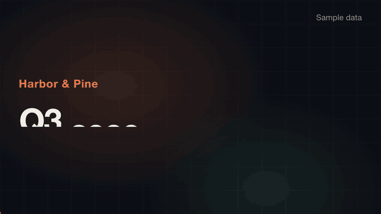

# open-motion

A free alternative to Claude Motion that works on any Claude plan, the free one included.

Claude Motion turns a report, a chart or a set of steps into a short animation written as code. As of 11 October 2026 it is in beta on Team and Enterprise plans only ([help page](https://support.claude.com/en/articles/17454997-get-started-with-claude-motion)); the [pricing page](https://claude.com/pricing) lists it as not included in Free, Pro or Max. This repo gives Claude the same job: it animates your text, charts, shapes and images in one HTML file, and the scripts here turn that file into an MP4 on your own computer. No video model, so no generated footage or people.

The prompt is in [PROMPT.md](PROMPT.md). Paste it into Claude Code (Pro and Max), or into a plain Claude chat on the free plan.



The example above was made from [example/report.md](example/report.md) with one line: "Turn this quarterly report into a 20-second explainer for our all-hands. 16:9." The report is sample data about a made-up company.

## On the free plan

The free plan has no Claude Code, so Claude writes the files and you run the scripts:

1. Paste [PROMPT.md](PROMPT.md) into a Claude chat with your report or data.
2. Save the `index.html` and `content.json` it gives you into an empty folder.
3. Clone this repo next to them and run the three commands from "Run by hand" on that folder. The scripts serve the folder themselves; opening `index.html` by double-click shows nothing, because the page loads `content.json` over http.
4. If `check.mjs` prints a FAIL, paste its output and `out/sheet.png` back into the chat and ask for a fix.

## What's inside

| Script | Does |
|---|---|
| `scripts/look.mjs` | Claude can't watch a video. This captures frames at the times you ask for and tiles them into one contact sheet, `out/sheet.png`, that it can open and describe |
| `scripts/check.mjs` | Measures what a reviewer would look for and exits 1 on failure: the animation is a pure function of time, every word on screen comes from `content.json`, no resting text is cut off, text is readable on a phone, the MP4 has the right length and size, no blank frames, no long freeze |
| `scripts/render.mjs` | Captures every frame from `seek(t)` and pipes it to ffmpeg. Writes `out/video.mp4` (H.264). Muxes `audio.wav` or `audio.mp3` if the project has one |

No packages to install. The scripts drive your own Chrome over the DevTools protocol.

## Change one value, keep the rest

Every word, number, colour and scene length lives in `content.json`. The page reads it and hard-codes nothing, and `check.mjs` fails if a word on screen is not in that file. To change the Q3 number, edit one line and render again:

```json
{ "id": "revenue", "seconds": 4.5, "label": "Revenue", "value": 4.8, "prefix": "$", "suffix": "M" }
```

## The contract

A project is a folder with `index.html` and `content.json`. The page defines:

- `window.DURATION` – length in seconds
- `window.SIZE` – `[width, height]`, default `[1920, 1080]`; use `[1080, 1920]` for vertical
- `window.FPS` – optional, default 30
- `window.seek(t)` – puts the whole page into its exact state for time `t`
- `window.ready` – optional Promise the scripts wait for
- `window.CONTENT` – the loaded `content.json`

`seek(t)` must be a pure function of `t`: the scripts ask for times in any order and must get the same picture each time. So no free-running CSS animations or transitions, no `setTimeout`, no `Date.now()`, no unseeded `Math.random()`.

## Requirements

- [Node.js](https://nodejs.org) 22 or newer
- Chrome, Chromium, Edge or Brave. If it is not found, set `MOTION_CHROME` to the browser executable
- [ffmpeg](https://ffmpeg.org) and ffprobe on PATH

## Run by hand

```bash
node scripts/look.mjs example --sheet 12       # frames you can look at
node scripts/render.mjs example                # example/out/video.mp4
node scripts/check.mjs example                 # PASS / WARN / FAIL per check
```

## What it does not do

- It is not Claude Motion and has no editor: you change the animation by editing `content.json` or by asking Claude.
- It makes no sound. For sound effects placed from the timeline, see [opus-sound-layer](https://github.com/Bodila51/opus-sound-layer).
- The checks measure layout and timing. They do not judge whether the animation is good; look at the contact sheet and the video yourself.
- The content check reads words of three or more letters. A number typed straight into `index.html` passes it.

## Licence

MIT. Not affiliated with or endorsed by Anthropic. Claude is a trademark of Anthropic.
